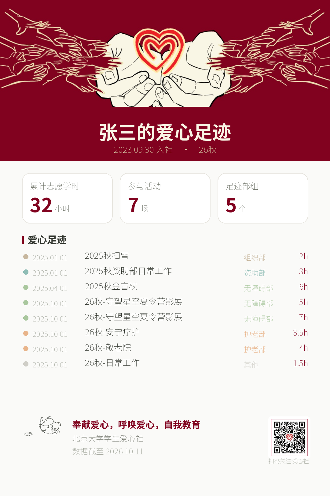

# 爱心社「爱心足迹」查询系统

北京大学学生爱心社的社员活动记录查询系统。输入姓名与学号，就能看到自己在爱心社的完整足迹：
参加过哪些活动、各拿多少志愿学时、在哪些部组留下过脚印，并能导出一张可以分享的海报。

<p align="center">
  
</p>

> 上面这张是演示数据生成的海报示例（`AX_DEMO=1` 用的内置假数据）。

---

## 功能

- **一个入口查两个学年库**：自动同时查询 `25-26` 与 `26-27` 两个飞书多维表格，
  同一个人在两个库里的档案会自动合并。
- **零硬编码的活动发现**：遍历多维表格的 Block 树，凡是「有字段指回社员档案主表」的表
  就自动认定为活动问卷表；表所在的**文件夹层级**直接给出所属部组。
  新增活动表之后**不需要改任何代码**。
- **按活动实际归属打部组标签**：护老部、无障碍部、儿童部……来自表格的真实归档位置，
  不是社员入社时填的「感兴趣的部组」。
- **时间轴 + 学时明细**：按参与时间排序，逐个活动列出学时、评分与感想。
- **参与浓度聚合**：足迹部组数、活动场次、学期分布，以及「与 N 位伙伴同行」（按需计算）。
- **导出与分享**：活动记录 CSV；一键生成 1080×1620 竖版爱心足迹海报。
- **入社日期口径透明**：优先采信档案里填写的真实日期；没有日期字段时用首次入档时间估算，
  并在页面上明确标出「真实填写」还是「约为首次入档时间」。

## 视觉

- **顶部品牌带**用社团官方栏图（手 + 心），裁掉原图上的文字与二维码后作为版头；
  原图里的二维码单独提取出来放进了海报页脚，扫码即可关注。
- **配色**取自社团的配色卡（低饱和 Morandi 色系）：深红 `#81021F` 作主品牌色，
  蓝 `#99CDD8`、雾 `#D6E4E3`、藕 `#F3D9D3`、珊瑚 `#F3B2B2`、灰 `#D9D6D3`、
  鼠尾草 `#657166` 作中性色与点缀。
- 部组色标也是同一族低饱和色，避免和整体调性打架。
- 设计源文件在 `docs/栏图.png` 与 `docs/配色卡.png`，派生出的素材在 `assets/logo/`。

## 隐私

- 只查询用户本人输入的那一条记录，**不展示任何其他社员的信息**。
- 身份证号、志愿者编号、微信号等敏感字段，在代码层就被排除在请求的字段投影之外，
  既不会被读取，也不会进入内存、页面或导出文件。这一条有单元测试守着（见 `tests/`）。
- 飞书应用密钥只从 `.streamlit/secrets.toml` 读取，该文件已被 `.gitignore` 排除。

---

## 快速开始

### 1. 取飞书应用凭证

任选一个来源：

**A. 从已部署的 Streamlit 应用里抄（最快）**

1. 打开 <https://share.streamlit.io>，用 GitHub 登录
2. 找到已部署的爱心足迹应用 → 右上角 `⋮` → **Settings**
3. 左侧选 **Secrets**，复制那段配置

**B. 从飞书开放平台抄**

1. 打开 <https://open.feishu.cn/app>，进入你的应用
2. 「凭证与基础信息」→ 复制 **App ID** 与 **App Secret**

### 2. 填写本地密钥

编辑 `.streamlit/secrets.toml`（仓库里已放好模板），把 `[feishu]` 段填上：

```toml
[feishu]
app_id = "cli_xxxx"
app_secret = "xxxx"
```

`[base_25_26]` / `[base_26_27]` 两段的 `base_token` 与 `main_table_id` 已经填好，不用改。

> 这个文件已被 `.gitignore` 排除，**永远不会被推到 GitHub**。
> CI 里还有一道扫描，确认它没有被误提交。

### 3. 给应用开通权限（**这一步最容易漏**）

飞书自建应用要能读到多维表格，必须同时满足两件事：

**① 开通接口权限**

在「权限管理」里开通下表中的权限，然后**创建版本并发布**（不发布不生效）：

| 权限 | 是否必需 | 用途 |
|---|---|---|
| `bitable:app` | **必需** | 读写多维表格的字段与记录 |
| `base:block:read` | **强烈建议** | 读取文件夹层级——这是判断「活动属于哪个部组」的**唯一**来源 |

> 只开通 `bitable:app` 也能跑，但拿不到文件夹结构，所有部组标签会统一退化成「其他」。
> 页面顶部会给出明确提示。想看到真实部组分布，就把 `base:block:read` 一起加上。

**② 把应用添加为每个多维表格的协作者**

打开该多维表格 → 右上角**分享** → 添加文档应用（搜索应用名，或直接填 App ID）
→ 权限选**可编辑**（这两个库都开启了高级权限，需要给它一个能读全部表的角色）。

> **两个库都要做**：`爱心社社员档案（25-26）` 与 `爱心社社员档案（26-27）`。
> 漏掉任何一个，那个库的数据就完全查不到——页面会出现「部分数据缺失」的提示。
>
> 常见报错对照：
> - `The role has no permissions`（code 1254302）→ 该库还没把应用加为协作者
> - `One of the following scopes is required: [base:block:read]` → 权限没开通或没发布版本

### 4. 本地运行

```bash
pip install -r requirements.txt
streamlit run app.py
```

浏览器打开 <http://localhost:8501> 即可。

**没有密钥也想先看看界面？** 演示模式会用内置的假数据跑起来：

```bash
# macOS / Linux
AX_DEMO=1 streamlit run app.py

# Windows cmd
set AX_DEMO=1 && streamlit run app.py
```

### 5. 部署到 Streamlit Community Cloud

1. 把代码推到一个新的 GitHub 仓库（`secrets.toml` 不会跟着上传）
2. 打开 <https://share.streamlit.io> → **New app** → 选仓库与分支 → 主文件填 `app.py`
3. **Advanced settings** 里 Python 版本选 **3.11**
4. 应用创建后进 **Settings → Secrets**，把第 2 步的 TOML 全文粘进去
5. 打开站点，验证查询、刷新、导出 CSV、生成海报

> 中文字体已随仓库提交（`assets/fonts/NotoSansSC-VF.ttf`，SIL OFL 开源许可）。
> 不要换成微软雅黑 / 黑体——那些是专有字体，放进公开仓库有授权风险。

---

## 支持的链接参数

可以直接带参查询，也方便把链接贴给别人：

```
https://<你的站点>/?name=张三&sid=2300017473
```

打开后会自动填入并立即查询。

---

## 架构

```
app.py                        Streamlit 入口
config.py                     常量：字段白名单/敏感黑名单、部组配色、学期归一、字段探测正则
feishu/                       数据层（唯一发网络请求的地方）
  protocol.py                 BitableClient 协议 —— 测试与真实实现的唯一缝
  client.py                   HTTP 客户端：token 复用、指数退避重试、字段投影守卫
  schema.py                   把飞书两种接口形态的 JSON 归一成一种形状
  registry.py                 活动注册表：遍历 Block 树 + 探测 link 字段 + 文件夹推导部组
  member_query.py             单成员跨库查询与参与判定
  models.py                   ActivityTable / Participation / Footprint …
  fake.py                     内存版客户端（测试与演示共用同一份）
services/                     业务层（纯函数，无网络、无 Streamlit）
  identity.py                 学号/姓名归一化、跨库合并
  membership_date.py          入社日期口径
  footprint.py                学时汇总、时间轴排序、聚合、同行统计
  poster.py                   Pillow 服务端渲染分享海报
  schema_refresh.py           表结构变更时重建依赖并重试一次
ui/                           视图层
  theme.py                    注入品牌样式与图片资源
  components.py               自绘 HTML 组件（统计卡 / 时间轴 / 部组色标）
  animations.py               心跳 loading、卡片入场、数字滚动
  pages.py                    页面编排
  state.py                    缓存与会话状态
assets/                       栏图、社徽、吉祥物小爱、二维码、开源中文字体、样式表
docs/                         设计源文件（栏图 / 配色卡）、海报样张、数据结构分析报告
scripts/verify_live.py        真实接口联调自检
tests/                        单元测试与录制的接口 fixture
.github/workflows/ci.yml      跑测试 + 密钥扫描
```

**数据流**：`主表关联列 → 活动表 record_id → 参与记录 → 学时 → 汇总`。

两条查询通道，自动择一：

- **关联通道（快）**：主表的关联列里存着「这个人参加过哪几场活动」的 record_id，
  直接按 id 精确取数。完全规避重名问题，一次请求一张表。
- **扫表通道（兜底）**：当某个人的关联列**一个都没填**时（早期数据没维护、或同步流程没跑），
  关联通道不可信，此时会自动退化成逐表扫描，按 `关联 record_id > 学号 > 姓名` 的优先级判定。
  只凭姓名命中的记录会被标为「待确认」，不会静默计入学时。

> 这个降级逻辑不是过度设计：真实数据里确实存在关联列全空的档案，
> 只走关联通道会把他们的参与记录**全部漏掉**。

---

## 数据口径与已知限制

| 项目 | 口径 |
|---|---|
| 主键 | 归一化后的「姓名 + 学号」。学号在 25-26 库是数字字段、26-27 库是文本字段，代码里统一归一成纯数字字符串 |
| 活动名 | 表格名去掉「反馈、学时问卷」等后缀 |
| 部组 | 表格在 Base 里的文件夹归属，不是问卷里填的「感兴趣的部组」 |
| 学期 | 由文件夹名或表名里的「2025秋 / 26春」推导，并统一成四位年份 |
| 入社日期 | 两库全部记录取最早。优先「入社日期」字段真实值；缺失则用记录创建时间（≈ 首次填写招新问卷），并标记为估算 |
| 志愿学时 | 学时字段名不统一（「志愿时长」/「志愿学时」/「工时」），按正则探测；同一条记录有多个学时字段时求和 |
| 时间轴排序 | 参与时间 → 学期标签 → 记录创建时间，三级回退 |

**已知限制**

1. 入社日期字段的默认值是「记录创建时间」，对于 25 秋之前导入的历史数据，档案里也标注了
   「日期仅为大概指示」，因此早期社员的日期可能偏晚。
2. 「与 N 位伙伴同行」需要扫活动表，因此只在点击时按需计算，且默认最多统计 30 场活动。
3. 只凭姓名匹配的记录存在同名误判可能，已用「待确认」标签显式提示。
4. 活动注册表缓存在内存中（TTL 24 小时）。骨干新增活动表后，用户点一次页面上的
   **刷新数据** 即可立刻看到。
5. 缺少 `base:block:read` 权限时会**降级运行**：活动表仍能被自动发现、学时照常统计，
   但部组标签统一显示为「其他」。补上权限并发布版本后自动恢复，无需改代码或改配置。
6. **查不到时会说明是哪一项没对上**，而不是笼统的「没找到」：姓名在档案里查不到、
   姓名查到了但学号对不上、姓名查到了但那条档案没填学号（历史数据里有一批这样的记录）。
   三种都给出同一个自助出口 —— 补录问卷。
   > 归因复用查询时的两次检索结果，**不额外发请求**。
7. **表结构被改动时会自愈**：骨干把某一列改名或删掉之后，缓存了 24 小时的旧字段名会让
   那张表整体报错。此时系统会丢弃注册表缓存、重新探测一次再重试，用户端无感。
   这里特意**不做**「把未知字段悄悄丢掉继续查」—— 学时字段一旦被改名，
   丢掉它的结果就是整张表的学时静默变成 0，比报错危险得多。
8. **限流会被识别并退避重试**。⚠️ 飞书旧版接口把限流报成 **HTTP 400 + code 99991400**
   （而不是 429）；只按状态码判断会把请求直接判死，导致被限流的那张活动表被静默丢弃，
   而注册表要缓存 24 小时。实测修复前连跑三次得到 169 / 165 / 171 张表。

> ⚠️ **遍历范围是红线。** 查询只会扫「该人有主表记录的那些库」的活动表，
> 永远不扩大到全部库 —— 活动表扫描是整条链路里最贵的一步，而飞书 API 调用量有月度上限。
> `tests/test_member_query.py::test_collect_participations_never_widens_scope` 守着这条线。

## 维护者工具

改了数据层代码之后，用真实密钥跑一遍自检，确认「活动发现 → 成员查询 → 学时汇总」整条链路还通：

```bash
python scripts/verify_live.py              # 全量自检
python scripts/verify_live.py --skip-query # 只建注册表，不查具体社员
```

它会打印：接口版本（新版 base/v3 还是回退旧版）、是否降级、两个库各自发现多少张活动表、
部组分布、字段探测抽样、敏感字段泄漏检查，以及一次真实社员查询的结果。
打印姓名时做脱敏处理，不会把社员个人信息写进日志。

---

## 测试

```bash
pip install -r requirements.txt -r requirements-dev.txt
python -m pytest
```

全部测试使用内存版客户端（`feishu/fake.py`）与录制的 JSON fixture，**不触网、不需要密钥**。
覆盖的关键行为包括：

- token 复用与续期、429 退避重试、403 不回退重试、新旧接口自动回退
- 学号「数字字段 ↔ 文本字段」归一、姓名空白归一
- 活动表动态发现、部组来自文件夹而非问卷、排除主表自关联字段
- 学时字段命名差异（志愿时长 / 志愿学时）都能识别
- 同名不同人的严防误判（link record_id 优先）
- 单表失败隔离、单库不可读时降级
- 敏感字段永不进入请求投影或结果（隐私回归）
- 入社日期口径、时间轴三级排序、汇总聚合
- 海报渲染、HTML 转义、widget key 唯一性

---

## 常见问题

**页面提示「小爱同学没有找到你的档案」**
姓名或学号与入社问卷填写的不一致。系统只做精确匹配（忽略空格）。确实入社过的话，可以走页面上的补录问卷链接。

**页面顶部出现「有 N 处数据没能取到」**
某张活动表读不到（通常是权限或该表被高级权限挡住）。其余数据仍然正常，提示里会列出是哪几张表。

**查不到 26-27 学年的活动**
该应用还没被添加为 26-27 库的协作者。见上面第 3 步。

**海报里中文变成方框**
中文字体没随之部署。确认 `assets/fonts/NotoSansSC-VF.ttf` 已提交进仓库。

---

## 许可

代码供北京大学学生爱心社内部使用。字体 `assets/fonts/NotoSansSC-VF.ttf` 采用 SIL Open Font License 1.1。
